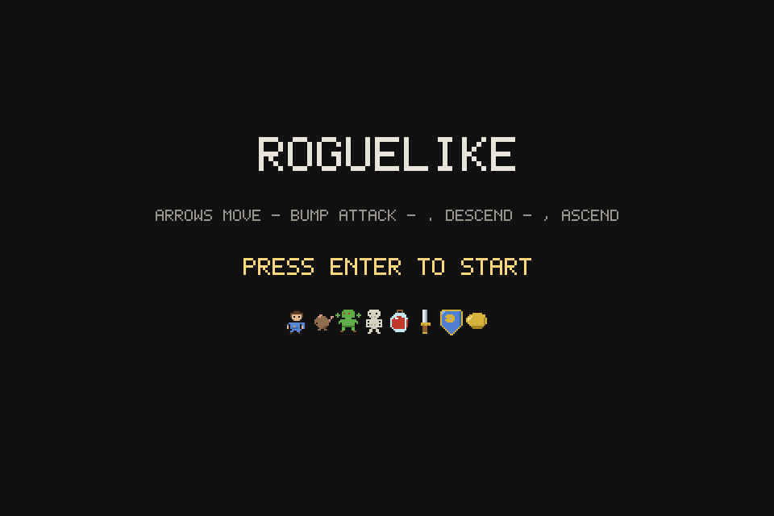
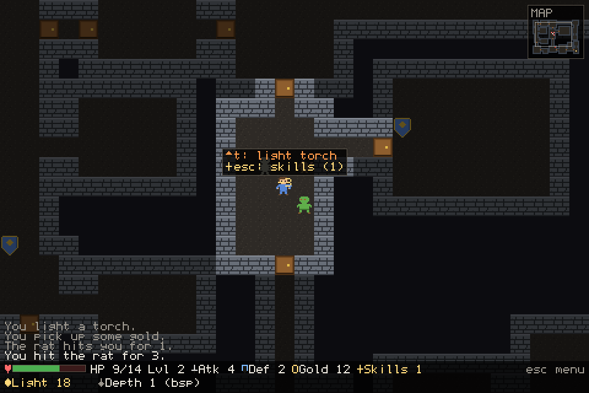
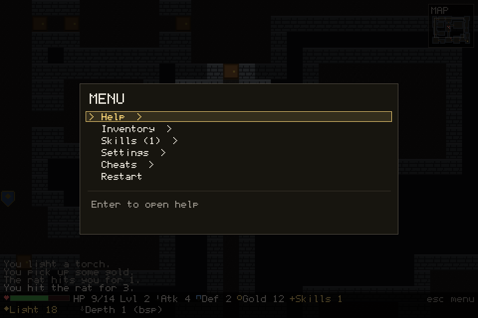

# roguelikeopencode

A small browser roguelike built with Bun, TypeScript, and a custom Strata-style canvas engine.

This project is also a small test for the capabilities of open source coding models, using:

- Strata engine: https://github.com/Niko1221/Strata
- qwen3.8-flash-next-iq3_xxs
- OpenCode: https://opencode.ai/

## Screenshots

### Title screen



### Dungeon gameplay



### Menu



## Game description

Explore procedurally generated dungeon levels, fight monsters with bump combat, collect items, and descend deeper through stairs. The game uses tile-based rendering, field of view, explored map memory, simple monster AI, inventory, potions, gold, equipment pickups, level ups, and a keyboard-driven menu.

Monsters include rats, goblins, and skeletons. Items include potions, swords, shields, gold, and corpses.

## Controls

| Key | Action |
| --- | --- |
| Arrow keys | Move or bump attack |
| Home, PageUp, End, PageDown | Diagonal movement |
| `.` | Descend stairs |
| `,` | Ascend stairs |
| `g` | Pick up item |
| `u` | Drink potion |
| `i` | Toggle inventory |
| `Esc` | Open or close menu |
| `Enter` | Start game, confirm menu, or restart after death |

The game has synthesized music and sound effects. Toggle them from the in-game menu under `Settings > Sound`. Contextual key hints appear near the player for pickup, stairs, and drinking potions.

## Commands

Install dependencies:

```bash
bun install
```

Run the development server with live reload:

```bash
bun run dev
```

Open:

```text
http://localhost:3000
```

Build the static game bundle:

```bash
bun run build
```

Verify and serve the built bundle:

```bash
bun run verify
bun run serve
```

Open:

```text
http://localhost:4173
```

Type check:

```bash
bun run typecheck
```

Run tests:

```bash
bun test
```

Regenerate the tileset:

```bash
bun run tiles
```

Regenerate README screenshots:

```bash
bun run screenshots
```

This project was created using `bun init` in Bun v1.4.3. [Bun](https://bun.com) is a fast all-in-one JavaScript runtime.
